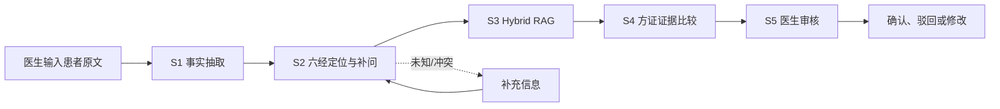

# 六经辨证临床辅助 Agent

基于 LangGraph、结构化大模型和《伤寒论》来源证据的医生侧临床辅助系统。系统将患者原文转化为可追溯的临床事实，完成六经定位、经典证据检索与方证鉴别，并在最终环节交由医生审核。

> **重要声明**：本项目是研发和工程验证系统，不是自动诊疗、处方或急救系统。当前测试集为研发银标，尚未完成独立中医专家盲审，不应直接用于临床决策。

## 项目亮点

- **证据链可追溯**：事实保留连续原文 span、极性、时点和来源状态；方证输出绑定真实 `Evidence ID` 与知识版本。
- **五阶段临床图**：S1 事实抽取 → S2 六经定位/补问 → S3 Hybrid RAG → S4 方证比较 → S5 医生审核。
- **模型与知识解耦**：LLM、Embedding、Reranker、Milvus、PostgreSQL 和 LangGraph Checkpoint 均通过配置和工厂注入。
- **人机协同**：不把未知当阴性，不强行压成单一六经；支持多候选、补充问题、暂停、断线恢复和医生确认。
- **可靠性优先**：结构化 Schema、来源核验、候选身份绑定、幂等会诊、SSE 事件恢复，以及安全诊断日志共同保证可审计性。
- **可复现实验**：在线评测保存逐例客户端记录、阶段事件、后端安全诊断日志和运行指纹，便于定位 S1–S4 问题。

## 系统流程



### 设计边界

- 未提及、未知、否定和阳性事实保持区分；未知不会被自动当作反证。
- S2 负责形成检索导向的宽候选，不直接调用在线 RAG 决定方证。
- S3 只返回真实知识证据和有限候选；来源召回分不等于患者适用性。
- S4 由模型进行一次批量比较，程序只校验来源、事实、候选、路径身份和排名结构，不生成医学评分。
- S5 的医生动作才是会诊完成入口；`awaiting_doctor_review` 不表示医生已经批准。

## 快速开始

### 环境

- Windows / PowerShell（其他平台可按同等 Python 命令运行）
- Python 3.11+
- 已配置的 Conda 环境：`langgraph`
- 可用的 OpenAI-compatible LLM、Embedding 和 Reranker 服务
- 本地开发可使用 Milvus Lite 和 SQLite Checkpoint；生产部署应使用受管的 Remote Milvus 与 PostgreSQL

不要提交 `.env`、API 密钥、数据库密码、患者原文、索引文件或运行报告。先复制模板并填写本地配置：

```powershell
Copy-Item .env.example .env
```

### 启动 Console

在项目根目录执行：

```powershell
conda run --no-capture-output -n langgraph python scripts/start_console.py
```

打开：

- 工作台：<http://127.0.0.1:8000/dashboard>
- API 文档：<http://127.0.0.1:8000/docs>
- 就绪检查：<http://127.0.0.1:8000/api/v1/health/ready>

也可以在 Windows 双击 [`start_console_windows.bat`](start_console_windows.bat)。

### 安全后端诊断日志

在线实验前建议为后端启用脱敏 JSONL 诊断日志。日志只记录结构化错误位置、阶段、校验类型和安全运行指纹，不记录密钥、患者全文、模型 JSON 或隐藏推理：

```powershell
conda run --no-capture-output -n langgraph python scripts/start_console.py `
  --diagnostic-log "..\实验记录\my_run\backend.jsonl"
```

## 在线实验

评测脚本位于 [`eval/v2_online_eval.py`](eval/v2_online_eval.py)，支持逐例记录、进度显示、原子保存、幂等恢复和 `--resume` 续跑。实验产物应放在项目目录之外，例如 `..\实验记录\`。

### 36 例标准研发集

数据集：[`eval/datasets/36/SixChannel_Standard36_Silver_v1.jsonl`](eval/datasets/36/SixChannel_Standard36_Silver_v1.jsonl)

终端一启动后端：

```powershell
$runDir = "..\实验记录\standard36_run"
New-Item -ItemType Directory -Force -Path $runDir, "$runDir\client" | Out-Null
conda run --no-capture-output -n langgraph python scripts/start_console.py `
  --diagnostic-log "$runDir\backend.jsonl"
```

终端二执行评测：

```powershell
$runDir = "..\实验记录\standard36_run"
conda run --no-capture-output -n langgraph python -u eval/v2_online_eval.py `
  --dataset eval/datasets/36/SixChannel_Standard36_Silver_v1.jsonl `
  --base-url http://127.0.0.1:8000 `
  --output "$runDir\report.json" `
  --records-dir "$runDir\client" `
  --backend-log "$runDir\backend.jsonl" `
  --timeout-seconds 1800 `
  --progress-seconds 5
```

首次运行必须使用新的 `--output`。中断后使用相同报告加 `--resume`；不要覆盖已有报告，也不要把远程服务器上的日志路径直接当成本地文件使用。

## 最近一次 36 例实验

实验记录目录：`..\实验记录\standard36_phase1_v2_20261018\`。配置为 `glm-5.3-flash`、知识库 `1.2`、Hybrid 检索和 Reranker；指标来自研发银标，不是临床准确率。

| 阶段/指标 | 结果 | 口径 |
|---|---:|---|
| 端到端完成率 | 100%（36/36） | 全部病例完成 S1–S4，无技术失败 |
| S1 事实抽取完成率 | 100%（36/36） | 结构化事实输出完成，不代表每条事实已专家验证 |
| S2 六经定位 Top-1 | 75.00% | 主参考六经命中 |
| S2 六经定位 Top-3 | 94.44% | 参考六经进入前三候选 |
| S3 方证证据 Top-5 | 75.00% | 参考方证进入检索证据池 |
| S4 方证鉴别正式排名 Top-1 | 79.41%（27/34） | 仅统计形成正式 `ranked` 的 34 例 |
| S4 正式排名形成率 | 94.44%（34/36） | 另 2 例进入 `insufficient`/`needs_clarification`，未强行给方 |

本轮的主要工程结论是：36 例全部完成，S4 结构错误和连续失败中止问题未再出现；剩余误差主要集中于太阴、少阴、厥阴边界，以及阳明/太阳内部相近方证的证据鉴别。测试集说明见 [`SixChannel_Standard36_Audit_Report.md`](eval/datasets/36/SixChannel_Standard36_Audit_Report.md)。

## API 与 Console 能力

- `POST /api/v2/consultations`：创建会诊并启动临床图。
- `GET /api/v2/consultations/{id}`：读取权威会诊快照。
- `GET /api/v2/consultations/{id}/events`：订阅 SSE 阶段事件。
- `GET /api/v2/consultations/{id}/events/page`：断线后按游标恢复事件。
- `POST /api/v2/consultations/{id}/clarify`：提交补充信息。
- `POST /api/v2/consultations/{id}/retry-s4`：仅重试方证鉴别阶段。
- `POST /api/v2/consultations/{id}/review`：提交医生审核动作。
- `/api/v2/knowledge/*`：独立的知识问答入口，与临床会诊线程隔离。

完整接口以运行中的 `/docs` 和当前 Pydantic Schema 为准。

## 项目结构

```text
backend/app/clinical_v2/       # 唯一临床领域包：S1–S4、Schema、验证和 Prompt
backend/app/graph/              # clinical-v2.0 LangGraph
backend/app/knowledge/          # KnowledgeService 与来源访问边界
backend/app/services/           # 会诊、审核、恢复、幂等和运行协调
backend/app/api/                # 薄 API/SSE 层
backend/app/static/             # 原生 Console 工作台
knowledge/v1.2/                 # 冻结知识快照与索引输入
eval/                           # 在线评测、指标比较和测试集
scripts/                        # 启动、索引和工程验收脚本
```

业务 Repository 保存会诊权威快照，LangGraph Checkpoint 只负责图恢复；QA 知识问答图与临床图保持隔离。

## 开发与质量检查

```powershell
conda run -n langgraph python -m ruff check backend scripts eval
conda run -n langgraph python -m black --config backend/pyproject.toml --check backend scripts eval
conda run -n langgraph python -m mypy --config-file backend/pyproject.toml backend/app
conda run -n langgraph python -m pytest backend/tests -c backend/pyproject.toml
```

或使用 Make：

```powershell
make test
make lint
make format-check
make typecheck
```

工程测试验证软件契约、状态恢复、来源绑定、RAG 接口和日志安全性；它们不等于医学临床验证。

## 当前限制与后续方向

- 36 例标签仍为研发银标，需独立中医专家盲审后再讨论临床有效性。
- `awaiting_doctor_review` 只表示等待医生操作，不表示系统自动批准。
- Lite 向量后端适合本地研发，不等同于生产部署；生产环境需要明确的 Remote Milvus、PostgreSQL、权限与隐私方案。
- 后续将针对错误病例逐例优化 S2 候选边界、S3 方证召回和 S4 相近方证鉴别，并保持可追溯证据链。

## 版本与贡献

当前开发分支：`V2.1优化`。提交前请阅读 [`AGENTS.md`](AGENTS.md)、[`CODEX_DEVELOPMENT_STANDARD_V2.md`](CODEX_DEVELOPMENT_STANDARD_V2.md) 和 [`handoff.md`](handoff.md)，并确保不提交凭据、患者数据、数据库、索引或实验输出。

欢迎通过 Issue 或 Pull Request 讨论工程问题、评测口径和知识来源；任何医学结论都需要相应来源和专家审核依据。
