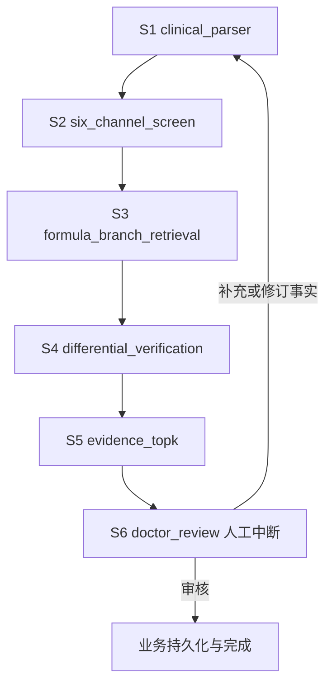

# V1.2 六阶段运行架构

本文件描述已实现的 `1.2-six-stage`，替代旧九阶段迁移计划。系统保存公开结构化状态、条件核验和来源；不保存模型隐藏推理。

## 工作流

子图只注册 S1–S5，主图包裹推理协调和人工审核。S6 不伪装为自动模型阶段，不写入自动 `completed_stages`；Console 按真实业务审核状态展示。知识 QA 使用独立图，不继承临床 Checkpoint。

## S1：事实

规则模式使用受支持词项、复合脉、局部否定和时间识别。LLM 模式先输出紧凑事实草稿，再验证原文、否定、时间和事实来源。医生结构化编辑优先；同键冲突与历史表现不能充当当前正证。未知不等于阴性。

规则模式不覆盖所有口语表达。病例输入应在启动辨证前核对结构化事实；缺失或误判的事实会影响全部后续阶段。

## S2：八纲与宽候选

八纲在同一节点内由确定性规则生成四轴倾向。六经允许独立多候选，最多保留六经，不做 softmax 单分类。

当前规则宽分按支持条目数除以四封顶，并扣明确阴性反证。LLM 模式只提议宽候选，分数由程序重算，来源核验形成 Pass B。该宽分是召回启发式，不是方证核心主证的医学标定值。

## S3：方证分支

KnowledgeService 检索方证及 FPEU 单条经典分支，默认召回池上限 12，与最终 Top-K 分开。分支保留 parent、条文号、Evidence ID、原文和审校状态，禁止同一方不同条文条件交叉累加。

未专家审核的派生分支保持 pending/indirect；历史方证归属不能升级成经典规则。来源校验不等于临床有效性审核。

## S4：关系与鉴别

关系模块核验当前证据与时间条件，关系未定时保持独立候选。S4 从完整方证池一次扫描 53 条原始鉴别规则，返回至少绑定双方的全部规则，不再截前八项或依赖逐对语义 Top-K。

规则局部匹配方名与唯一别名。双方来源条件须可归属且完整解析；共同支持不形成独有鉴别加分，单方说明不补造另一方条件。复杂病机、治疗、可能性、非必要性和不能完整解析的长条件保留 Unknown。S5 评分重新核验双方来源值，防止篡改及不完整绑定。

没有适用规则或结构化条件不完整时，系统只能报告鉴别未解决，不能声称已区分所有候选。

## S5：来源、排序与补问

先对全部路径核验来源归属、完整条件和当前事实，再计算分数并截取 Top-K。召回相关度与重排分数不直接等于患者支持。来源 ID、条件正反证、缺失项和分项记录供医生审计。

当前公开权重：核心 0.25、鉴别 0.25、经典 0.20、方证 0.10、时间 0.10、医案 0.05、上下文 0.05。高反证每项扣 0.35，普通反证每项扣 0.15，各惩罚封顶后扣减，最终分限制为 0–1。

经典/方证因子目前为 `支持条件数 / max(1, 支持与反证条件的并集数)`；Unknown 不进入分母。鉴别因子取有效单方支持权重的最大值。医案自动阶段已移除，医案因子为零；无独立核验器的上下文因子为零。覆盖率独立展示，不参与分数。

同分时按路径哈希 ID 稳定排序，没有医学优先级。UI 的支持数合并六经与方证字段，和计分来源条件口径不同。当前评分饱和、同分顺序及共同症状归属问题已列入发布限制，尚未完成优化。

补问仅来自完整可执行的来源条件，最多三条 pending；复杂说明不自动转成患者问题。达到轮次上限或没有可执行问题时交医生审核，不自动补事实。

## S6：医生审核与恢复

医生补证后在新轮次从事实阶段安全重算；采用、驳回、修改、备注等动作经业务服务持久化。后台运行使用任务记录、锁、幂等与恢复协调，终态与审核事实不能由前端猜测。

新图使用 `six-stage-v1.2:` 物理线程命名空间。旧九阶段 `doctor_wait` 活跃状态不直接恢复；旧协议重跑必须明确拒绝或建立新版本轮次，不能把旧完成阶段映射为新阶段。未上线阶段已获允许不迁移旧业务数据；后续生产迁移必须重新制定数据策略。

## 基础设施与边界

LLM/Embedding/Reranker、VectorStore、业务数据库与 Saver 均从配置工厂注入。KnowledgeService 是唯一医学知识访问边界。Remote/Lite 分支仅在向量适配器与工厂，PostgreSQL/SQLite Saver 只替代图状态。

应用 lifespan 创建并关闭基础设施，不能每请求创建 Saver。开发业务数据库故障可以内存兜底；生产仍要求业务 PostgreSQL。结构化日志保留请求、会诊与线程标识，禁止记录密钥、密码、完整患者信息或隐藏推理。

## 验证

`backend/tests/` 覆盖事实三值、来源适用性、鉴别、评分、图节点、补证、审核、恢复、API、Remote/Lite 与 Postgres/SQLite 分支。离线检索和工程病例、浏览器 E2E 由统一验收入口执行。工程通过不能替代专家标注、在线模型质量或真实部署验证。
